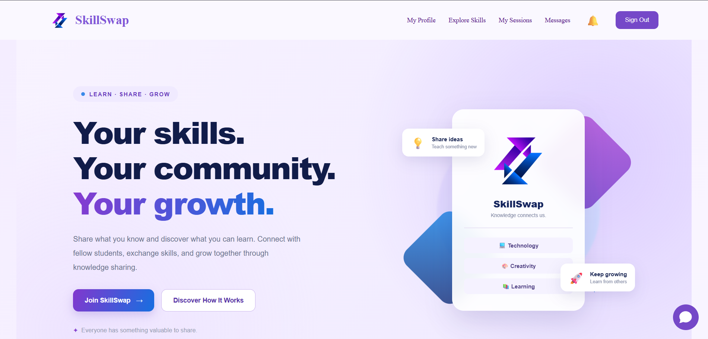
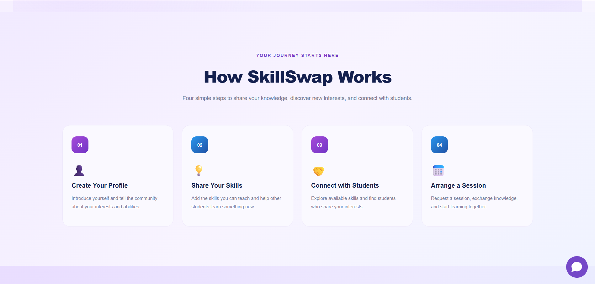
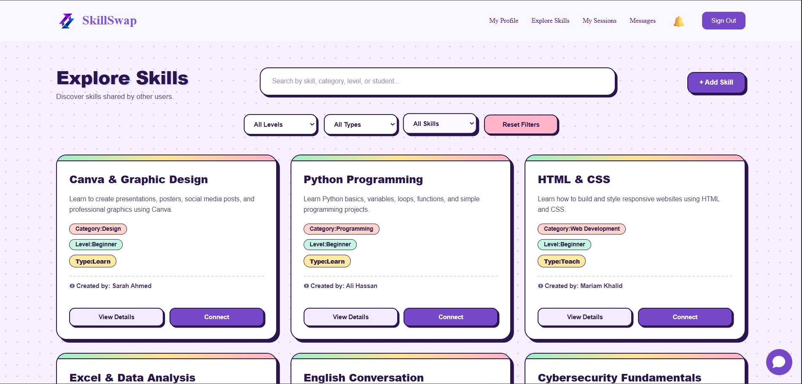
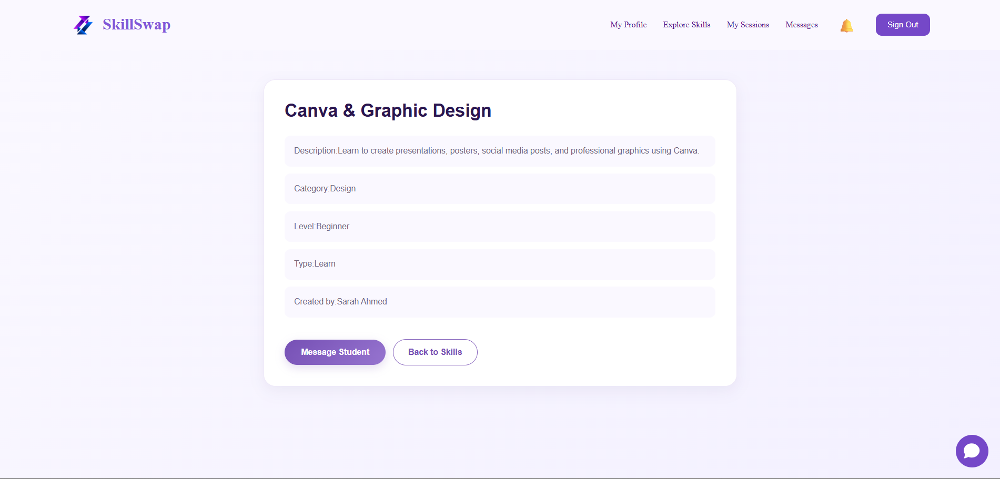
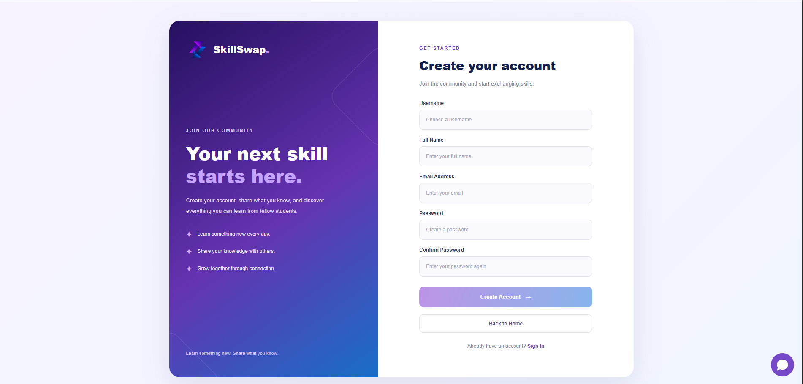
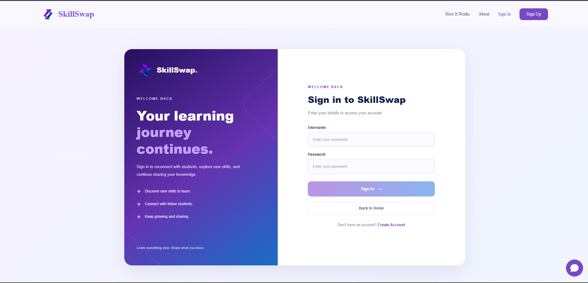
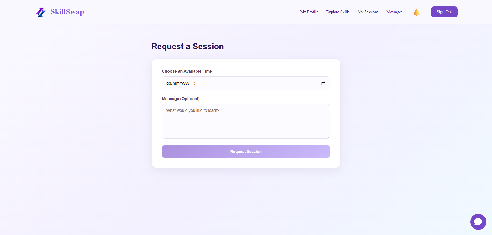
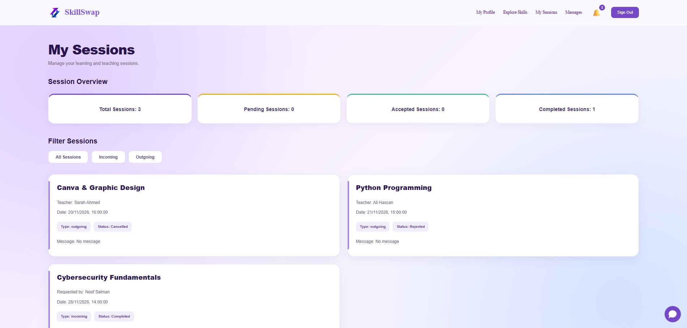
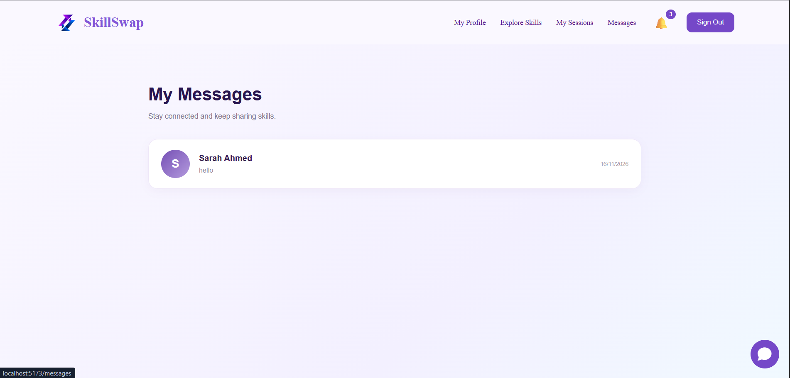
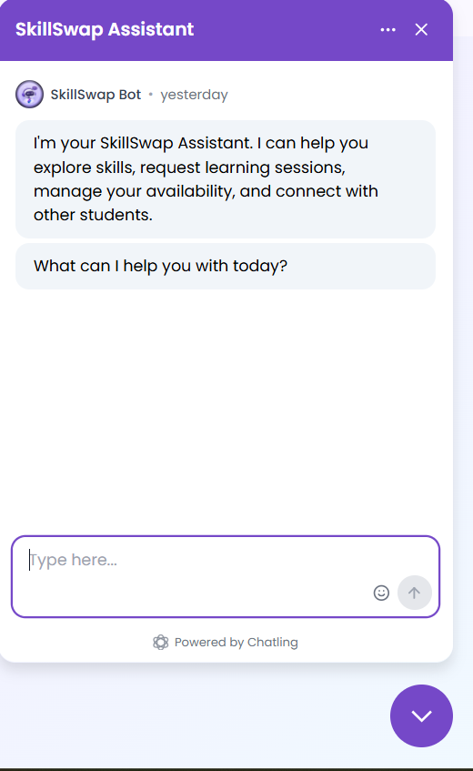

# SkillSwap Frontend

## Overview

SkillSwap is a student-to-student skill exchange web application where students can share skills they know, discover skills they want to learn, and connect with other students.

Users can create an account, log in, explore skills, and create listings under two categories: **Teach** and **Learn**.

Students can click the **Connect** button on another student's skill to request a session. For Teach skills, students select from the skill owner's available dates and times. For Learn skills, students can propose a future date and time.

The application also includes session management, notifications, an availability calendar, and an AI chatbot to help users navigate the platform.

This repository contains the frontend of SkillSwap, built using React and Vite.

## Live Application

- **Frontend:** https://skillswap100.netlify.app/
- **Backend API:** https://project-3-backend-y717.onrender.com
- **Backend Repository:** https://github.com/raf266/Project-3-backend

## Screenshots

### Home Page



### How SkillSwap Works


### Explore Skills


### Skill Details


### Sign Up


### Sign In


### Request a Session


### My Sessions


### Messages


### AI Chatbot


## Technologies Used

- **React** — Building the user interface
- **Vite** — Frontend development and build tool
- **JavaScript** — Application functionality
- **React Router** — Client-side navigation
- **Axios** — Sending HTTP requests to the backend API
- **CSS** — Styling pages and components
- **Chatling.ai** — AI chatbot integration

## Features

- User registration and login
- Protected features for authenticated users
- Browse available skills
- Search skills by keywords
- Filter skills by level and Teach/Learn type
- Filter listings to show the current user's skills
- Create and view skill listings
- Connect with other students
- Request sessions for both Teach and Learn skills
- Select available teaching slots for Teach skills
- Propose future session dates for Learn skills
- Manage incoming and outgoing session requests
- Accept or decline session requests
- Cancel and complete sessions
- Add teaching availability using a calendar
- Receive notifications about session activity
- Ask questions using the SkillSwap AI chatbot

## Project Structure

The main frontend files and directories include:

```text
frontend/
├── public/
│   ├── favicon.svg
│   ├── icons.svg
│   ├── logo.png
│   └── skillswap-logo.png
├── src/
│   ├── assets/
│   ├── components/
│   │   ├── AvailabilityCalendar.css
│   │   ├── AvailabilityCalendar.jsx
│   │   ├── Navbar.css
│   │   └── Navbar.jsx
│   ├── pages/
│   │   ├── AddSkill.css
│   │   ├── AddSkill.jsx
│   │   ├── AuthPage.css
│   │   ├── Chat.css
│   │   ├── Chat.jsx
│   │   ├── Dashboard.jsx
│   │   ├── EditSkill.css
│   │   ├── EditSkill.jsx
│   │   ├── ExploreSkills.css
│   │   ├── ExploreSkills.jsx
│   │   ├── Homepage.css
│   │   ├── Homepage.jsx
│   │   ├── Messages.css
│   │   ├── Messages.jsx
│   │   ├── MySessions.css
│   │   ├── MySessions.jsx
│   │   ├── Profile.css
│   │   ├── SessionRequest.css
│   │   ├── SessionRequest.jsx
│   │   ├── SigninPage.jsx
│   │   ├── SignupPage.jsx
│   │   ├── SkillDetails.css
│   │   └── SkillDetails.jsx
│   ├── services/
│   │   ├── api.js
│   │   ├── authService.js
│   │   └── sessionService.js
│   ├── App.css
│   ├── App.jsx
│   ├── index.css
│   └── main.jsx
├── .env
├── .gitignore
├── eslint.config.js
├── index.html
├── package.json
└── README.md
```

## Getting Started

### Prerequisites

Install the following before running the project:

- Node.js
- npm
- Git

The SkillSwap backend must also be running for API-dependent features to work.

**Backend Repository:** https://github.com/raf266/Project-3-backend

## Installation

### 1. Clone the repository

```bash
git clone https://github.com/raf266/SkillSwap-Frontend.git
cd SkillSwap-Frontend
```

### 2. Install dependencies

```bash
npm install
```

### 3. Create the environment file

Create a `.env` file in the root directory:

```env
VITE_BACK_END_SERVER_URL=http://localhost:3000
```

Change the URL if your backend uses another port or a deployed server.

### 4. Start the development server

```bash
npm run dev
```

Open the local address displayed in the terminal, normally:

```text
http://localhost:5173
```

## Application Routes

| Route | Page | Access |
|---|---|---|
| `/` | Home Page | Public |
| `/skills/new` | Create Skill | Authenticated |
| `/skills/:id` | Skill Details | Public or authenticated, depending on configuration |
| `/sessions/create/:skillId` | Request Session | Authenticated |
| `/my-sessions` | My Sessions | Authenticated |


## User Stories

- As a student, I want to create an account so that I can access SkillSwap.
- As a student, I want to log in securely so that I can manage my skills and sessions.
- As a student, I want to browse skills so that I can discover learning opportunities.
- As a student, I want to search and filter skills so that I can find relevant listings.
- As a student, I want to post a Teach skill so that I can share my knowledge.
- As a student, I want to post a Learn skill so that I can find someone who can help me.
- As a student, I want to connect with another student so that we can arrange a session.
- As a student, I want to select an available time so that I can request a convenient session.
- As a skill owner, I want to accept or decline requests so that I can manage my sessions.
- As a student, I want to track my sessions so that I know whether they are pending, accepted, or completed.
- As a student, I want to receive notifications so that I know when my session status changes.
- As a student, I want to use an AI chatbot so that I can get help navigating the website.

## Future Enhancements

- Real-time chat between students
- Email reminders for upcoming sessions
- Ratings and reviews after completed sessions
- Improved availability and scheduling features
- Better session role descriptions for Teach and Learn skills
- Enhanced mobile responsiveness
- Improved chatbot capabilities

## Team Members

| Name | GitHub |
|---|---|
| [Sara] | [https://github.com/SarahRedha23] |
| [Waad] | [https://github.com/waad333-w] |
| [Raghad] | [https://github.com/raf266] |

## Credits

- [React](https://react.dev/)
- [Vite](https://vite.dev/)
- [React Router](https://reactrouter.com/)
- [Axios](https://axios-http.com/)
- [Chatling.ai](https://chatling.ai/)


**Frontend Repository:** https://github.com/raf266/SkillSwap-Frontend

**Backend Repository:** https://github.com/raf266/SkillSwap-Backend
